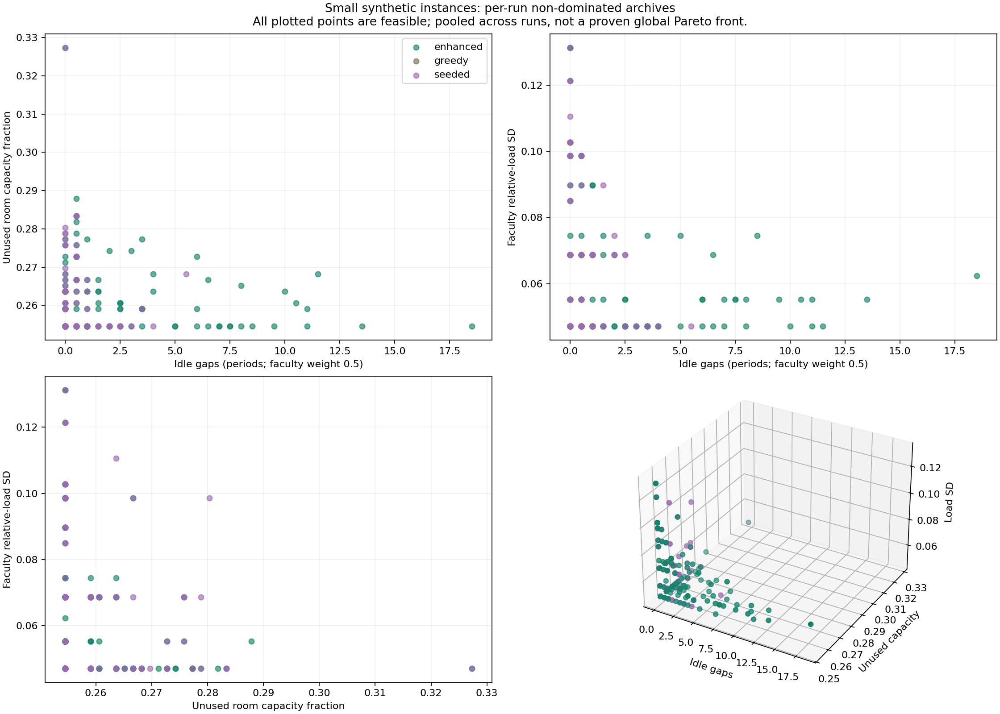
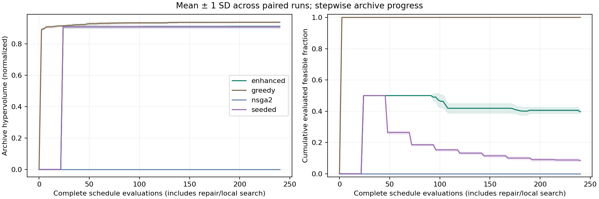

# Multi-Objective College Timetable Optimization

A tested Python system for assigning weekly college sessions to time blocks, compatible rooms and eligible faculty, with explicit hard constraints and three quality objectives.

**Final audit:** 209 tests pass. Clean installation, all three CLI problem sizes, saved measurements, report and slides were checked. The [audit report](docs/final_audit.md) includes an exact-arithmetic correction for reported fronts; printed hypervolume comparisons are unchanged.

The supplied proposal and professor's assignment are primary references. The [reference review](docs/reference_review.md) explains corrections and scope decisions. **All college datasets and experimental results are synthetic.** No institutional measurements, student contribution history or professor approval are invented.

## 1. Group details

Four-member, eight-week Optimization Techniques project. Full member names, roll numbers, usernames, group number, professor and approval date were not supplied; the group must complete these before academic submission. This local implementation does not establish individual student authorship.

## 2. Problem statement

A timetable coordinator must schedule every required session while respecting attendance, room resources, faculty qualifications, availability and teaching limits. A two-period lab occupies both periods and cannot cross lunch. Feasible schedules can differ in seat wastage, idle gaps and workload balance. See [problem scope](problem/README.md).

## 3. Formulation summary

Decisions are discrete: one `(start, room)` pair per event and **one eligible teacher per offering**, shared by all its sessions. The exact formulation uses joint binary event/start/room/faculty variables coupled to offering-level teacher variables. See the [complete mathematical model](formulation/README.md).

All objectives are minimized:

1. Student internal free teaching periods plus `0.5 ×` faculty internal free teaching periods; mandatory lunch is excluded.
2. Duration-weighted unused fraction of seats during scheduled room use.
3. Population standard deviation of faculty `weekly teaching periods / weekly allowance`.

Teacher selection makes workload genuinely variable. Room wastage measures seat fit, not campus room-hour utilization. Hard constraints cover complete demand, consistent eligible teachers, room/faculty/student clashes, capacity/type, full-block availability, lunch/day boundaries, daily/weekly teaching limits and configurable distinct teaching days. Shared events occupy every listed atomic cohort. The problem is deterministic, discrete, constrained and combinatorial; workload SD is nonlinear.

## 4. Methods implemented

| Method | Location | Role |
|---|---|---|
| Greedy/DSatur-style | `src/timetable/greedy.py` | Dynamic saturation/scarcity/degree ordering; offering-atomic teacher choice; compactness and room-fit placements |
| Repeated greedy | `src/timetable/experiments.py` | Strong equal-budget baseline retaining a non-dominated archive of repeated constructions |
| Standard NSGA-II | `src/timetable/nsga2.py` | Random categorical initialization, constrained dominance, ranking/crowding, tournaments, whole-offering crossover, mutations and elitist survival |
| Initialization-only ablation (`seeded`) | Same NSGA-II core | Half the initial population is constructed greedily; no repair/local search |
| Enhanced NSGA-II | `src/timetable/hybrid.py` and NSGA-II | Constructive initialization, inheritance-biased reconstruction repair and bounded feasible local search, including whole-offering teacher exchanges |
| Feasible-domain memetic NSGA-II (`memetic`) | `src/timetable/memetic.py`, `feasible.py`, `faculty_search.py` | Fully feasible initialization, resource-checked mutation, bounded batch faculty reassignment and genuine NSGA-II selection/survival |
| Follow-up comparison | `src/timetable/comparison.py` | Paired evaluation/time protocols, timestamped cutoff archives and scalar-local ablation |
| Disruption re-optimisation | `src/timetable/disruption.py` | Minimal-change repair with a broken-session lower bound, and ε-constraint NSGA-II trading changed sessions against f₁–f₃ after a teacher absence/departure or room closure ([details](docs/disruption.md)) |
| Exact references | `src/timetable/exact.py` | Optional CP-SAT feasibility/gaps/room models, weighted-sum and ε-constraint runs for the two-objective (gaps, room) front; exhaustive tiny Pareto fronts without a solver dependency |
| MOEA/D *(supplementary)* | `src/timetable/moead.py` | Decomposition with Tchebycheff or weighted-sum scalarization on the same feasible moves; matched study in `results/moead_paired` |
| AMOSA *(supplementary)* | `src/timetable/amosa.py` | Archived multi-objective simulated annealing; single-run demonstrations only |
| Decision support *(supplementary)* | `src/timetable/mcdm.py` | TOPSIS ranking, AHP-derived weights with consistency ratio, weight-sensitivity analysis |

**The validated final method is the memetic NSGA-II.** The rows marked *supplementary* were added after the held-out study was frozen; their narrower evidence, including a small matched study in which MOEA/D led on two large instances, is in [advanced methods](docs/ot_advanced_methods.md). The `data/itc_inspired` instance is synthetic, not an official ITC benchmark.

Every full evaluator call counts, including initialization, repaired candidates and local-search proposals. Internal constructive checks are timed but do not count as complete objective evaluations. Equal evaluation budgets do not imply equal compute; runtime is also reported. No solver receives the separate feasibility certificate. The enhancement is a hypothesis to evaluate, not an assumption of superiority. An exact integer load-partition relaxation in `experiments/certify_small_ideal.py` certifies all three default small-instance ideal vectors. See [method rationale](literature/README.md) and [exact guarantee boundaries](docs/exact.md).

## 5. Repository structure

```text
main.py                       CLI driver
src/timetable/
  model.py                    Typed schema, domains, JSON serialization
  generation.py               Configurable planted-feasible synthetic datasets
  evaluation.py               Independent constraints, objectives and practical metrics
  greedy.py                   Constructive baseline
  nsga2.py                    Standard NSGA-II and search orchestration
  hybrid.py                   Original repair and local-search operators
  feasible.py / faculty_search.py  Feasible moves and bounded faculty search
  memetic.py / comparison.py  Follow-up optimizer and equal-resource comparisons
  exact.py                    CP-SAT and exhaustive references
  metrics.py                  Sorting, exact 3-D hypervolume, spacing, comparisons
  experiments.py              Budgets, checkpoints, analysis and representatives
  export.py / visualization.py / cli.py
api/                          Website backend: server.py (runs), bridge.py (format), optimizer.py, campus/ (app)
frontend/                     Clockwork website (React + Vite + TypeScript)
 tests/                       Constraint, objective, algorithm and integration tests
 experiments/                 Configs, export and independent verification scripts
 data/                        Synthetic instances; separate certificate folders
 results/                     Raw runs, tables, timetable grids and verification logs
 figures/                     Generated scientific plots and timetable images
 problem/ literature/ formulation/ docs/
 report/ presentation/        Academic report, slides, demo and viva guide
 work/                        Ignored scratch files
```

## 6. Requirements

Python **3.11+**; tested on Linux with Python 3.12. NumPy and Matplotlib support analysis/plots. The optimizer and separate checker are transparent Python. Saved schedules are rechecked outside search with this common checker; hand-calculated tests and CP-SAT provide additional independent checks. Pytest is used for tests; OR-Tools is optional for CP-SAT. No GPU, database or paid account is required for the optimizer; the optional website uses FastAPI, SQLite (standard library) and Node 18+. Exact tested versions are in `requirements-lock.txt` and experiment manifests.

## 7. Installation

From an extracted review archive or the cloud repository, run in Bash:

```bash
python3 -m venv .venv
source .venv/bin/activate
python -m pip install --upgrade pip
python -m pip install -r requirements-lock.txt
python -m pip install -e . --no-deps
python -m pytest -q
```

The lock file covers the optimizer, tests and CP-SAT only. **For the website also run** `python -m pip install -r requirements.txt` (adds FastAPI/uvicorn/httpx) and `npm --prefix frontend ci` (Node 18+). A flexible install is `python -m pip install -e '.[test,exact,web]'`; omit `exact` to avoid OR-Tools. Core optimization and exhaustive micro examples work without it. On Windows PowerShell activate `.venv\Scripts\Activate.ps1` instead.

Repository: <https://github.com/akshattikaria/Optimization-Project-OT-BY-AKSHAT-MANAV-KRISH-PARTH>. The original benchmark belongs to commit `9947d9d`; the current project includes the completed follow-up and its measured source snapshot. To clone:

```bash
git clone https://github.com/akshattikaria/Optimization-Project-OT-BY-AKSHAT-MANAV-KRISH-PARTH.git
cd Optimization-Project-OT-BY-AKSHAT-MANAV-KRISH-PARTH
```

## 8. How to run

Generate, solve and independently validate:

```bash
python main.py --help
python main.py generate --size small --seed 42 --output data/demo.json --certificate data/certificates/demo.json
python main.py evaluate data/demo.json data/certificates/demo.json
python main.py solve data/demo.json --method greedy --seed 0 --budget 240 --output results/demo_greedy --figures figures/demo_greedy
python main.py solve data/demo.json --method memetic --seed 0 --budget 240 --population 24 --output results/demo_memetic --figures figures/demo_memetic
python main.py evaluate data/demo.json results/demo_memetic/timetables/normalized_compromise/schedule.json
python experiments/exact_fronts.py --instance data/demo.json --run results/demo_memetic/run.json --output results/demo_memetic/exact_front.json
```

The final recommended method is `--method memetic`; optional `--search-seconds 6` caps its native search time. Use `--method enhanced` to reproduce the original repair-based method, `--method nsga2` for the standard comparator, or `--method seeded` for the initialization-only ablation. The CLI's original default is retained for compatibility; select the final method explicitly. At a small budget, standard NSGA-II may find no feasible schedule. The CLI saves diagnostics and returns code 2 instead of exporting an invalid timetable. A search failure is not an infeasibility proof. `validate` aliases `evaluate`; code 0 means feasible, 2 means infeasible/no feasible result (or a standard argument-usage error), and 1 means a data/dependency/I/O error.

Each feasible result includes event CSV/JSON, Markdown weekly grids and **per-group, per-faculty and per-room CSV grids**. Four representative selections can coincide. The compromise minimizes Euclidean distance to the observed archive's normalized ideal; it is not claimed to be a unique knee.

Exact references:

```bash
python main.py prove-tradeoffs
python main.py solve data/reference_small10.json --method cpsat --objective gaps --time-limit 20 --seed 0 --output results/cpsat_reproduction_gaps
python main.py solve data/reference_small10.json --method cpsat --objective room --time-limit 20 --seed 0 --output results/cpsat_reproduction_room
```

Verify/replot the historical benchmark and export its baseline comparisons (its measured source remains associated with commit `9947d9d`):

```bash
python experiments/verify_saved_results.py --study benchmark
python experiments/certify_small_ideal.py --study benchmark
python main.py plot --results results/benchmark --figures figures/benchmark
python experiments/export_review.py --study benchmark
```

Resume checks existing run identities and schedules and requires matching source, configuration, Python, dependencies and platform. It preserves original measurements. To run **fresh solver measurements** beside the supplied records:

```bash
mkdir -p work
python - <<'PY'
import json
from pathlib import Path
config = json.loads(Path('experiments/benchmark.json').read_text())
config['name'] = 'benchmark_reproduction'
Path('work/reproduce.json').write_text(json.dumps(config, indent=2))
PY
python main.py experiment --config work/reproduce.json
python experiments/verify_saved_results.py --study benchmark_reproduction
python experiments/export_review.py --study benchmark_reproduction
```

`experiments/smoke.json` is a shorter all-size study. `experiments/full_study.json` defines five instances and 30 solver seeds per instance at larger budgets; **a runnable configuration is not a completed measurement**. See [experiment protocol](experiments/README.md).

### Web application (Clockwork frontend)

The project also runs as a website: the Clockwork frontend and its application layer (accounts and roles, timetable
views, Pareto explorer, calendar, teacher availability, leave, substitute requests, quizzes/extra classes, online
assessments, holidays, syllabus completion, notifications) on top of **this repository's final memetic NSGA-II**.
Website runs also execute the repeated-greedy baseline with the same evaluations and seed, re-check every timetable
with the independent evaluator, and refuse to publish an infeasible one. MOEA/D, AMOSA and standard NSGA-II run
only when the optional *Advanced benchmark* is ticked; the website shows measured values only and marks anything else
"Not run".

```bash
python -m pip install -r requirements.txt
npm --prefix frontend ci
python -m uvicorn api.server:app --port 8000    # terminal 1
npm --prefix frontend run dev                   # terminal 2, then open http://localhost:5173 (admin / admin)
```

If port 8000 is taken, start uvicorn on another port and the frontend with `CLOCKWORK_API=http://127.0.0.1:<port>`.
With both servers running on a fresh database, `python experiments/web_integration_check.py --web http://localhost:5173`
runs the 61-point end-to-end check ([latest results](docs/final_integration_check.md)).

See [web application guide](docs/web_application.md) and [accounts and calendar rules](docs/accounts-and-calendar.md).

## 9. Data

Presets contain 40/150/400 events, 2/8/20 atomic cohorts, 5/12/25 rooms and 6/20/50 faculty. The five-day, eight-period grid blocks period index 4 for lunch. Class strengths cycle through 24/36/48/54 and room capacities through 30/45/60/90. Repeated theory sessions occur on distinct days; labs last two periods.

The generator builds a feasible weekly certificate before sampling qualifications and availability consistently with it. That certificate is independently validated, saved separately and excluded from optimizer inputs/metadata. This **conditions sampling on feasibility** and can favor constructive methods. Faculty/resource slack is simplified; real-data and ITC benchmark validation are not claimed. See [schema, assumptions and all configurable parameters](data/README.md).

## 10. Results

See [the consolidated final report](report/report.md), [printable report](report/final_report.pdf), and [completed presentation and demo guide](presentation/README.md). Current measurements are in the [held-out summary](results/enhancement_validation/summary.md), [raw runs](results/enhancement_validation/runs.csv), and [manifest](results/enhancement_validation/manifest.json). Historical records remain available in `results/benchmark/`. Failed runs remain visible and receive hypervolume zero. Figures are generated from saved records.

Presentation: [editable PowerPoint](presentation/college_timetable_optimization.pptx), [PDF slides](presentation/college_timetable_optimization.pdf), and [complete presenter notes](presentation/presenter_notes.md). Optional document rebuild instructions are in [report/README.md](report/README.md) and the presentation guide.

<!-- enhancement-results:start -->

### Current results: feasible memetic NSGA-II

The held-out study completed **168 runs**. Verification rechecked all **3295 archived timetables**, seven feasibility certificates and every cutoff history; nine late completed evaluations were excluded. All 201 pre-freeze tests passed. The original historical benchmark remains unchanged.

**Final numerical audit:** exact-arithmetic cleanup retains **3,242 non-dominated records** from those 3,295 feasible archived schedules. It removes 53 points retained through floating-point workload ties; the maximum per-run HV change is **3.33 × 10⁻¹⁶**, so every printed value below is unchanged. Use the [canonical exact-front summary](results/exact_fronts/enhancement_validation/summary.md) for final fronts and retain the raw records for timing provenance. See [the precision finding and correction](docs/numerical_precision.md). New solve archives should pass through `experiments/exact_fronts.py` as shown above.

| Size | Protocol | Greedy mean HV | Final memetic NSGA-II mean HV | Relative HV change |
|---|---|---:|---:|---:|
| small | evaluations | 0.934747 | 0.930290 | -0.48% |
| small | wall_time | 0.929781 | 0.930290 | +0.05% |
| medium | evaluations | 1.008330 | 1.056105 | +4.74% |
| medium | wall_time | 0.988710 | 1.060477 | +7.26% |
| large | evaluations | 0.940824 | 0.977304 | +3.88% |
| large | wall_time | 0.930485 | 1.013967 | +8.97% |

The new variant won all nine paired runs in each medium/large condition, using unchanged data/model/indicators. Small results are mixed and do not establish a general improvement. The strong scalar-local ablation is competitive; NSGA-II selection itself has no consistent demonstrated advantage over it. With three independent primary instances per size, inferential power remains low. Higher HV does not imply every objective improved on every timetable.

See [the measured follow-up report](report/enhancement_report.md), [study protocol](docs/enhancement_study.md), and [operator invariants](docs/feasible_variation.md).


<!-- enhancement-results:end -->

The table above compares the **final `memetic` method** with greedy on the same held-out instances and paired seeds within each row. Evaluation and wall-time budgets are separate protocols. The historical study below used different instance/solver seeds, so its greedy means differ; compare methods within a study, not numbers across the two studies.

<details>
<summary>Historical benchmark: original repair-based enhancement (192 runs)</summary>

**Historical-study verification:** 136 tests passed, 192 benchmark runs and 109,440 charged search evaluations. The shared checker revalidated all 769 archived feasible schedules and seven separate instance certificates. Greedy, seeded and enhanced methods each had 48/48 feasible runs; plain NSGA-II had 0/48 at these caps. A clean virtual-environment installation was also tested.

The final exact-arithmetic audit retains **759** records after removing 10 numerically retained dominated points; [canonical historical fronts](results/exact_fronts/benchmark/summary.md) are saved separately. Rounded performance results are unchanged.

| Size | Greedy mean HV | Original enhanced mean HV | Greedy seconds | Original enhanced seconds |
|---|---:|---:|---:|---:|
| small | 0.935319 | 0.935173 | 7.918 | 2.432 |
| medium | 1.017029 | 0.981213 | 18.550 | 6.087 |
| large | 0.937241 | 0.909322 | 48.520 | 16.236 |

In the original study, repair-based `enhanced` NSGA-II was about three times faster but had lower mean hypervolume than repeated greedy. Small-instance quality was close; medium/large differences were larger. These results support feasibility recovery and runtime savings, not universal evolutionary superiority. Exact lower-bound certificates prove the three checked small instances have the singleton global ideal `(0,14/55,sqrt(1/450))`; multi-objective search is unnecessary for choosing among globally optimal objective vectors there. Larger-instance trade-offs remain empirical.




Heuristic archives are non-dominated over discovered feasible schedules. Exhaustive micro-instances and independently certified small-instance ideal vectors have global guarantees; other fronts are empirical. Objective conflict is investigated per instance; it is not assumed. CP-SAT `OPTIMAL` certifies the selected scalar objective, not the full multi-objective front.

</details>

## 11. Individual contributions

Personal contributions were not supplied and are **not retrospectively assigned**. The group must record authentic work, review, understanding and authorized commits. Suggested parallel responsibilities are model/formulation, algorithms, Pareto/verification, and data/experiments, with weekly cross-review. See [the evidence template](docs/project_plan.md).

## 12. Weekly progress log

Eight weeks of personal development history cannot be created in one cloud task. Technical artifacts and verification records exist; historical weekly participation is unrecorded. The [prospective eight-week plan](docs/project_plan.md) supplies parallel tasks without inventing dates or commits. The original project was published in one authorized commit (`9947d9d`); the completed follow-up and final presentation are published as a separate authorized update. This publication records the delivered work and does not establish eight weeks of individual participation.

## 13. References

Deb et al., NSGA-II (2002), DOI [10.1109/4235.996017](https://doi.org/10.1109/4235.996017); Brélaz, DSatur (1979), DOI [10.1145/359094.359101](https://doi.org/10.1145/359094.359101); Schaerf, automated timetabling survey (1999); Lewis, university timetabling metaheuristics survey (2008); Zitzler et al., multi-objective performance assessment (2003); Google OR-Tools CP-SAT documentation. Full titles, identifiers and precise roles are in [literature/README.md](literature/README.md). Attached academic references are mapped in [docs/reference_review.md](docs/reference_review.md).

## Enhancement method and reproduction

The final `memetic` method, whose measured results appear in [Section 10](#10-results), addresses the high rate of infeasible offspring, while preserving the historical algorithms, datasets and indicator definitions. It uses 24 feasible constructive seeds, five resource-checked mutation neighborhoods, bounded batch faculty assignment, and the existing tested NSGA-II ranking/crowding/survival core. A scalar-local ablation retains the same initialization/proposal family and removes the selection/survival bundle. The method intentionally omits destructive crossover.

The completed predeclared validation matrix has 168 runs on separate instance seeds, with both equal full-evaluation caps and equal wall-time allocations. Late completed results are excluded from cutoff quality; initialization and all partial checks are timed. The larger development matrix is supplied but was not run in full. See [the study protocol](docs/enhancement_study.md) and [the measured follow-up report](report/enhancement_report.md).

```bash
python main.py solve data/demo.json --method memetic --seed 0 --budget 360 --population 24 --search-seconds 6 --output results/memetic_demo --figures figures/memetic_demo
python main.py compare --config experiments/enhancement_validation.json --resume
python experiments/verify_enhancement.py --study enhancement_validation
python experiments/exact_fronts.py --study enhancement_validation
python experiments/plot_enhancement.py --study enhancement_validation
python experiments/export_enhancement.py --study enhancement_validation
python experiments/report_enhancement.py --study enhancement_validation
```

For fresh follow-up measurements, copy `experiments/enhancement_validation.json`, change its `name`, and run `compare --config YOUR_CONFIG.json`. Historical `results/benchmark` cannot be resumed under the changed package-source fingerprint; verify/replot it or run a newly named original-method study instead. The new comparison saves a complete measured source snapshot, per-candidate timing/duplicate information, paired statistics and separate feasibility certificates.
