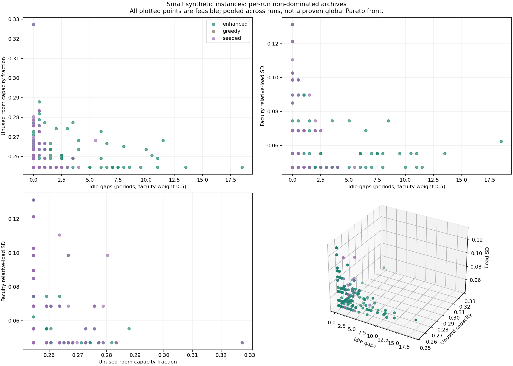
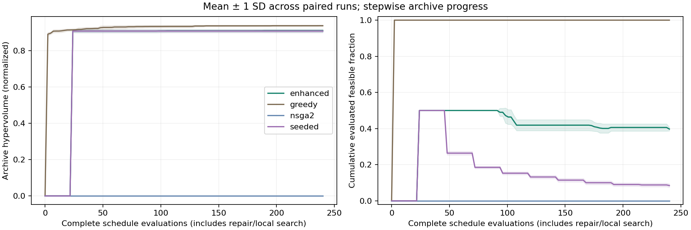

# Multi-Objective College Timetable Optimization

A tested Python system for assigning weekly college sessions to time blocks, compatible rooms and eligible faculty, with explicit hard constraints and three quality objectives.

The supplied proposal and professor's assignment are primary references. The [reference review](docs/reference_review.md) explains corrections and scope decisions. **All college datasets and experimental results are synthetic.** No institutional measurements, student contribution history or professor approval are invented.

## 1. Group details

Four-member, eight-week Optimization Techniques project. Full member names, roll numbers, usernames, group number, professor and approval date were not supplied; the group must complete these before academic submission. This local implementation does not establish individual student authorship.

## 2. Problem statement

A timetable coordinator must schedule every required session while respecting attendance, room resources, faculty qualifications, availability and teaching limits. A two-period lab occupies both periods and cannot cross lunch. Feasible schedules can differ in seat wastage, idle gaps and workload balance. See [problem scope](problem/README.md).

## 3. Formulation summary

Decisions are discrete: one `(start, room)` pair per event and **one eligible teacher per offering**, shared by all its sessions. The exact formulation uses joint binary event/start/room/faculty variables coupled to offering-level teacher variables. See the [complete mathematical model](formulation/README.md).

All objectives are minimized:

1. Student internal free teaching periods plus `0.5 ×` faculty internal free teaching periods; mandatory lunch is excluded.
2. Duration-weighted unused fraction of seats during scheduled room use.
3. Population standard deviation of faculty `weekly teaching periods / weekly allowance`.

Teacher selection makes workload genuinely variable. Room wastage measures seat fit, not campus room-hour utilization. Hard constraints cover complete demand, consistent eligible teachers, room/faculty/student clashes, capacity/type, full-block availability, lunch/day boundaries, daily/weekly teaching limits and configurable distinct teaching days. Shared events occupy every listed atomic cohort. The problem is deterministic, discrete, constrained and combinatorial; workload SD is nonlinear.

## 4. Methods implemented

| Method | Location | Role |
|---|---|---|
| Greedy/DSatur-style | `src/timetable/greedy.py` | Dynamic saturation/scarcity/degree ordering; offering-atomic teacher choice; compactness and room-fit placements |
| Repeated greedy | `src/timetable/experiments.py` | Strong equal-budget baseline retaining a non-dominated archive of repeated constructions |
| Standard NSGA-II | `src/timetable/nsga2.py` | Random categorical initialization, constrained dominance, ranking/crowding, tournaments, whole-offering crossover, mutations and elitist survival |
| Initialization-only ablation (`seeded`) | Same NSGA-II core | Half the initial population is constructed greedily; no repair/local search |
| Enhanced NSGA-II | `src/timetable/hybrid.py` and NSGA-II | Constructive initialization, inheritance-biased reconstruction repair and bounded feasible local search, including whole-offering teacher exchanges |
| Exact references | `src/timetable/exact.py` | Optional CP-SAT feasibility/gaps/room models; exhaustive tiny Pareto fronts without a solver dependency |

Every full evaluator call counts, including initialization, repaired candidates and local-search proposals. Internal constructive checks are timed but do not count as complete objective evaluations. Equal evaluation budgets do not imply equal compute; runtime is also reported. No solver receives the separate feasibility certificate. The enhancement is a hypothesis to evaluate, not an assumption of superiority. An exact integer load-partition relaxation in `experiments/certify_small_ideal.py` certifies all three default small-instance ideal vectors. See [method rationale](literature/README.md) and [exact guarantee boundaries](docs/exact.md).

## 5. Repository structure

```text
main.py                       CLI driver
src/timetable/
  model.py                    Typed schema, domains, JSON serialization
  generation.py               Configurable planted-feasible synthetic datasets
  evaluation.py               Independent constraints, objectives and practical metrics
  greedy.py                   Constructive baseline
  nsga2.py                    Standard NSGA-II and search orchestration
  hybrid.py                   Actual repair and local-search operators
  exact.py                    CP-SAT and exhaustive references
  metrics.py                  Sorting, exact 3-D hypervolume, spacing, comparisons
  experiments.py              Budgets, checkpoints, analysis and representatives
  export.py / visualization.py / cli.py
 tests/                       Constraint, objective, algorithm and integration tests
 experiments/                 Configs, export and independent verification scripts
 data/                        Synthetic instances; separate certificate folders
 results/                     Raw runs, tables, timetable grids and verification logs
 figures/                     Generated scientific plots and timetable images
 problem/ literature/ formulation/ docs/
 report/ presentation/        Academic report, slides, demo and viva guide
 work/                        Ignored scratch files
```

## 6. Requirements

Python **3.11+**; tested on Linux with Python 3.12. NumPy and Matplotlib support analysis/plots. The optimizer and separate checker are transparent Python. Saved schedules are rechecked outside search with this common checker; hand-calculated tests and CP-SAT provide additional independent checks. Pytest is used for tests; OR-Tools is optional for CP-SAT. No GPU, web service, database or paid account is required. Exact tested versions are in `requirements-lock.txt` and experiment manifests.

## 7. Installation

From an extracted review archive or the cloud repository, run in Bash:

```bash
python3 -m venv .venv
source .venv/bin/activate
python -m pip install --upgrade pip
python -m pip install -r requirements-lock.txt
python -m pip install -e . --no-deps
python -m pytest -q
```

A flexible install is `python -m pip install -e '.[test,exact]'`; omit `exact` to avoid OR-Tools. Core optimization and exhaustive micro examples work without it. On Windows PowerShell activate `.venv\Scripts\Activate.ps1` instead.

Repository: <https://github.com/akshattikaria/Optimization-Project-OT-BY-AKSHAT-MANAV-KRISH-PARTH>. Current changes are intentionally uncommitted and unpushed, so a remote clone will not contain them until the owner reviews and publishes them. To clone after publication:

```bash
git clone https://github.com/akshattikaria/Optimization-Project-OT-BY-AKSHAT-MANAV-KRISH-PARTH.git
cd Optimization-Project-OT-BY-AKSHAT-MANAV-KRISH-PARTH
```

## 8. How to run

Generate, solve and independently validate:

```bash
python main.py --help
python main.py generate --size small --seed 42 --output data/demo.json --certificate data/certificates/demo.json
python main.py evaluate data/demo.json data/certificates/demo.json
python main.py solve data/demo.json --method greedy --seed 0 --budget 240 --output results/demo_greedy --figures figures/demo_greedy
python main.py solve data/demo.json --method enhanced --seed 0 --budget 240 --population 24 --output results/demo_enhanced --figures figures/demo_enhanced
python main.py evaluate data/demo.json results/demo_enhanced/timetables/normalized_compromise/schedule.json
```

Use `--method nsga2` for the standard comparator or `--method seeded` for the initialization-only ablation. At a small budget, standard NSGA-II may find no feasible schedule. The CLI saves diagnostics and returns code 2 instead of exporting an invalid timetable. A search failure is not an infeasibility proof. `validate` aliases `evaluate`; code 0 means feasible, 2 means infeasible/no feasible result (or a standard argument-usage error), and 1 means a data/dependency/I/O error.

Each feasible result includes event CSV/JSON, Markdown weekly grids and **per-group, per-faculty and per-room CSV grids**. Four representative selections can coincide. The compromise minimizes Euclidean distance to the observed archive's normalized ideal; it is not claimed to be a unique knee.

Exact references:

```bash
python main.py prove-tradeoffs
python main.py solve data/reference_small10.json --method cpsat --objective gaps --time-limit 20 --seed 0 --output results/cpsat_reproduction_gaps
python main.py solve data/reference_small10.json --method cpsat --objective room --time-limit 20 --seed 0 --output results/cpsat_reproduction_room
```

Run/resume the saved benchmark, independently verify every archived timetable, regenerate charts, and export baseline comparisons:

```bash
python main.py experiment --config experiments/benchmark.json --resume
python experiments/verify_saved_results.py --study benchmark
python experiments/certify_small_ideal.py --study benchmark
python main.py plot --results results/benchmark --figures figures/benchmark
python experiments/export_review.py --study benchmark
```

Resume checks existing run identities and schedules and requires matching source, configuration, Python, dependencies and platform. It preserves original measurements. To run **fresh solver measurements** beside the supplied records:

```bash
mkdir -p work
python - <<'PY'
import json
from pathlib import Path
config = json.loads(Path('experiments/benchmark.json').read_text())
config['name'] = 'benchmark_reproduction'
Path('work/reproduce.json').write_text(json.dumps(config, indent=2))
PY
python main.py experiment --config work/reproduce.json
python experiments/verify_saved_results.py --study benchmark_reproduction
python experiments/export_review.py --study benchmark_reproduction
```

`experiments/smoke.json` is a shorter all-size study. `experiments/full_study.json` defines five instances and 30 solver seeds per instance at larger budgets; **a runnable configuration is not a completed measurement**. See [experiment protocol](experiments/README.md).

## 9. Data

Presets contain 40/150/400 events, 2/8/20 atomic cohorts, 5/12/25 rooms and 6/20/50 faculty. The five-day, eight-period grid blocks period index 4 for lunch. Class strengths cycle through 24/36/48/54 and room capacities through 30/45/60/90. Repeated theory sessions occur on distinct days; labs last two periods.

The generator builds a feasible weekly certificate before sampling qualifications and availability consistently with it. That certificate is independently validated, saved separately and excluded from optimizer inputs/metadata. This **conditions sampling on feasibility** and can favor constructive methods. Faculty/resource slack is simplified; real-data and ITC benchmark validation are not claimed. See [schema, assumptions and all configurable parameters](data/README.md).

## 10. Results

See [the academic report](report/report.md), [benchmark summary](results/benchmark/summary.md), [raw measurements](results/benchmark/runs.csv), [manifest](results/benchmark/manifest.json) and `results/benchmark/runs/`. Failed runs remain visible and receive hypervolume zero. Figures are generated from saved records.

**Completed verification:** 136 tests passed, 192 benchmark runs and 109,440 charged search evaluations. The shared checker revalidated all 769 archived feasible schedules and seven separate instance certificates. Greedy, seeded and enhanced methods each had 48/48 feasible runs; plain NSGA-II had 0/48 at these caps. A clean virtual-environment installation was also tested.

| Size | Greedy mean HV | Enhanced mean HV | Greedy seconds | Enhanced seconds |
|---|---:|---:|---:|---:|
| small | 0.935319 | 0.935173 | 7.918 | 2.432 |
| medium | 1.017029 | 0.981213 | 18.550 | 6.087 |
| large | 0.937241 | 0.909322 | 48.520 | 16.236 |

Enhanced NSGA-II was about three times faster but had lower mean hypervolume than repeated greedy. Small-instance quality was close; medium/large differences were larger. These results support feasibility recovery and runtime savings, not universal evolutionary superiority. Exact lower-bound certificates prove the three checked small instances have the singleton global ideal `(0,14/55,sqrt(1/450))`; multi-objective search is unnecessary for choosing among globally optimal objective vectors there. Larger-instance trade-offs remain empirical.




Heuristic archives are non-dominated over discovered feasible schedules. Exhaustive micro-instances and independently certified small-instance ideal vectors have global guarantees; other fronts are empirical. Objective conflict is investigated per instance; it is not assumed. CP-SAT `OPTIMAL` certifies the selected scalar objective, not the full multi-objective front.

## 11. Individual contributions

Personal contributions were not supplied and are **not retrospectively assigned**. The group must record authentic work, review, understanding and authorized commits. Suggested parallel responsibilities are model/formulation, algorithms, Pareto/verification, and data/experiments, with weekly cross-review. See [the evidence template](docs/project_plan.md).

## 12. Weekly progress log

Eight weeks of personal development history cannot be created in one cloud task. Technical artifacts and verification records exist; historical weekly participation is unrecorded. The [prospective eight-week plan](docs/project_plan.md) supplies parallel tasks without inventing dates or commits. No commit, push, PR, merge or repository-permission change was performed.

## 13. References

Deb et al., NSGA-II (2002), DOI [10.1109/4235.996017](https://doi.org/10.1109/4235.996017); Brélaz, DSatur (1979), DOI [10.1145/359094.359101](https://doi.org/10.1145/359094.359101); Schaerf, automated timetabling survey (1999); Lewis, university timetabling metaheuristics survey (2008); Zitzler et al., multi-objective performance assessment (2003); Google OR-Tools CP-SAT documentation. Full titles, identifiers and precise roles are in [literature/README.md](literature/README.md). Attached academic references are mapped in [docs/reference_review.md](docs/reference_review.md).
