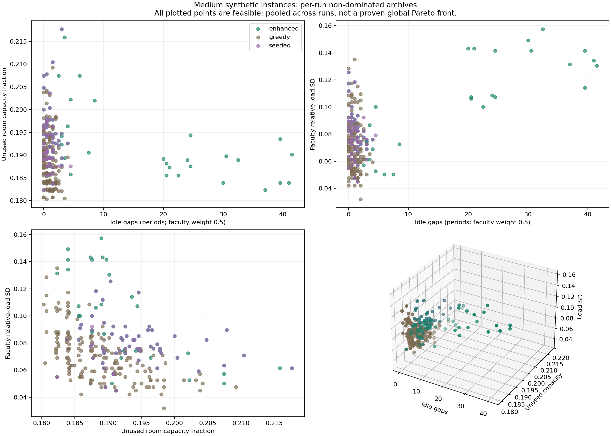
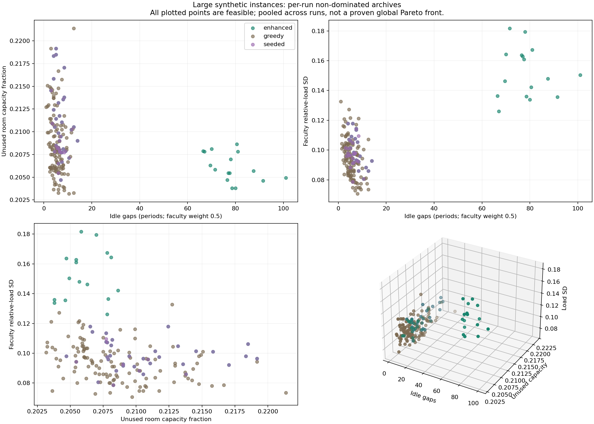
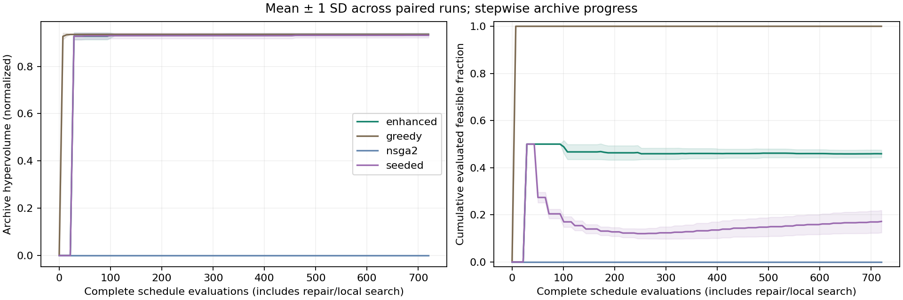

# Multi-Objective College Timetable Optimization: technical report

This report is generated from saved synthetic experiment records. It distinguishes
measured evidence, mathematical guarantees, and work still required for academic
submission. The project does not claim real institutional data or eight weeks of
student participation.

## 1. Introduction and real-world motivation

The timetable coordinator assigns required weekly teaching to times, rooms and
qualified faculty. Students and faculty need clash-free attendance and compact
days, while administrators care about room fit and fair teaching assignments.
Feasibility is mandatory; the three quality measures rank feasible alternatives.

## 2. Problem statement

An offering serves one or more disjoint atomic cohorts and requires fixed weekly
sessions. Its teacher is chosen once for the offering. Every session receives
one start and one room; multi-period events occupy their entire block. The week
repeats deterministically. The complete scope is in `problem/README.md`.

## 3. Literature review and existing approaches

The implementation is informed by Deb et al. (NSGA-II, 2002), Brélaz (DSatur,
1979), Schaerf (1999), Lewis (2008), Zitzler et al. (2003), and OR-Tools CP-SAT
documentation. Full bibliographic identifiers and precise uses appear in
`literature/README.md`. These references motivate methods; they do not establish
performance on the synthetic data used here.

## 4. Decision variables

For the exact model, binary `z[e,start,room,faculty]` selects one valid joint
alternative per event. Binary `y[offering,faculty]` selects one qualified teacher;
the event choices are linked to it. The heuristic uses equivalent categorical
event `(start,room)` genes and offering-level teacher genes. This avoids the
proposal's unlinearized product of teacher selection and occupancy decisions.

## 5. Objective functions

All objectives are minimized: `f1 = student gaps + 0.5 * faculty gaps`; `f2` is
the duration-weighted average unused fraction of room seats; `f3` is population
SD of faculty teaching load divided by weekly allowance. Lunch is excluded
from teaching gaps. Headcount, duration and required demand are fixed. Workload
can change because the selected teacher changes; all sessions of the offering
move together. Hand-calculated tests verify these definitions.

## 6. Constraints and assumptions

Required sessions must be complete; teachers must be eligible and consistent;
rooms, faculty and cohorts cannot clash; room capacity/type and full-block
availability must hold; labs cannot cross lunch or days; faculty daily/weekly
limits and optional distinct session days must hold. `evaluation.py` checks
each condition independently of search. The formulation and all equations are
in `formulation/README.md`.

Groups must be disjoint atomic cohorts. Common events can name multiple cohorts;
overlapping parent divisions and their batches must not be treated as independent
groups. Room kinds match exactly, and can encode specialized lab types in custom
data. The synthetic generator uses generic classrooms/labs and full-cohort labs.

## 7. Problem classification

This is a finite deterministic, constrained, discrete combinatorial
multi-objective problem. Feasibility and room fit have binary linear models;
gaps admit exact logical linear encodings; workload SD is nonlinear. Simplified
timetabling contains graph coloring. Continuous gradient methods do not directly
enforce categorical assignments and resource occupancy.

## 8. Baseline approach

The baseline is deliberately strong: whole offerings are placed with a dynamic
saturation/scarcity/degree heuristic, eligible teacher selection, gap-aware
placement and room fit. Repeated constructions use restricted candidate lists
and retain all feasible non-dominated objective vectors under the same complete
evaluation cap. The first attempt is deterministic. This is more demanding than
comparing against one poor greedy timetable. A public single-compromise greedy
function is also supplied.

## 9. Algorithm choice and justification

NSGA-II supports coupled categorical decisions and nonconvex discrete trade-offs.
The plain comparator uses independent domain-valid random initialization.
Feasible schedules are rare under that representation, so a domain enhancement
tests whether constructive initialization, repair and local search improve
feasibility and quality. The study retains a seeding-only ablation. More named
algorithms would add tuning complexity without automatically improving evidence.

## 10. Multi-objective formulation and guarantees

Deb's constraint-domination rule prioritizes feasibility, then smaller positive
violation, then Pareto dominance among feasible candidates. Clashes are not
traded against quality. An external archive retains distinct non-dominated
feasible objective vectors from every evaluated candidate. No infeasible
candidate contributes to hypervolume or timetable exports. A heuristic archive
is non-dominated over discovered schedules, not over every feasible timetable.

Two separate controlled micro-instances exhaust all choices and certify global
fronts. Room/compactness gives `(0,0.25,0)` versus `(1,0,0)` after 64 complete
evaluations. Workload/compactness gives `(0,0,0.5)` versus `(1,0,0)` after 9.
They demonstrate possible conflict without assuming a conflict on every college
instance. Complete schedules, not hand-drawn points, underlie these fronts.

## 11. Algorithm implementation

NSGA-II uses constrained sorting, normalized crowding, binary tournaments,
whole-offering uniform crossover, categorical time/room/teacher mutations and
elitist parent/offspring survival. Intelligent initialization fills half the
initial population using the same constructive mechanism as the baseline.
Repair reconstructs offerings while preferring inherited placements; it is not a
Kempe-chain method or minimum-disruption guarantee. Short local search proposes
adjacent placement, fitting rooms, load-aware teacher changes and cross-qualified
whole-offering teacher exchanges. Full feasibility is rechecked before local
acceptance, and a fresh positive scalar direction governs local improvement.
Pareto survival still uses the original three objectives.

All complete evaluator calls are charged, including failed repairs and rejected
local candidates. Partial resource/gap/load checks choose constructive proposals
but are not complete evaluator calls; their cost is included in runtime.

Automated verification: **136 passed in 12.20s** in the working environment; **136 passed in 7.80s** after installing the pinned dependencies into a new virtual environment from a fresh repository snapshot. This used a snapshot rather than a remote clone because changes remain uncommitted/unpushed. The fresh CLI generated, solved and validated a separate seed-42 instance, and the fresh environment rechecked every stored benchmark schedule. Dependency checks passed. Logs are in `results/verification/`.

## 12. Experimental setup

Executed study `benchmark` contains **192 runs**, **109,440
complete search evaluations**, and **7 distinct synthetic
instances**. All saved certificates and all 769
archived schedules were rechecked outside search with the common constraint checker. Hand calculations and CP-SAT are additional independent model checks. **48
runs have empty feasible archives** and remain in quality averages with HV=0.

The five-day eight-period grid blocks lunch index 4. Presets contain
40/150/400 events, 2/8/20 cohorts, 5/12/25 rooms and 6/20/50 faculty. Cohort
strengths cycle through 24/36/48/54; capacities through 30/45/60/90. Labs last
two periods. Faculty limits are 20 periods weekly and 6 daily. Qualifications
offer alternatives, and resource unavailability is sampled at rate 0.08 from
slots unused by a separately generated feasible certificate. This is a
**planted-feasible, potentially easy/slack distribution**, not an unbiased or
real institutional sample. The optimizer never receives the certificate.

Python: `3.12.14 (main, Aug 25 2026, 14:00:49) [Clang 22.1.3 ]`. Platform:
`Linux-6.18.55-x86_64-with-glibc2.41`. Recorded versions: `{'numpy': '2.3.5', 'matplotlib': '3.10.8', 'ortools': '9.15.6755', 'pytest': '8.4.2'}`.
Source SHA-256: `acee3ae94f29ff216939a5428c62a2a19d119fac997fc4c795ab50ec149e4b6a`. Exact configs, per-file source
hashes, instance hashes and seed IDs are in the manifest/raw records.

| Size | Independent instance seeds | Solver seeds per instance | Evaluation cap per method/run | Population |
|---|---|---:|---:|---:|
| small | [10, 20, 30] | 10 | 720 | 24 |
| medium | [10, 20] | 6 | 360 | 24 |
| large | [10, 20] | 3 | 240 | 24 |

Methods run sequentially, with execution order rotated by seed. Static domain
caches are shared within a process. Runtime includes search/construction/repair
but excludes result serialization, validation and plotting. Hardware/load affect
times; this is not a controlled isolated hardware benchmark.

Hypervolume is an exact 3-D union of dominated boxes. Normalization uses fixed
a priori bounds `D * teaching_periods_per_day * (groups + 0.5*faculty)`, `1`,
and `0.5`, with reference `(1.1,1.1,1.1)`. It does not fit scales to each
method or run. The loose gap bound can underweight compactness in this indicator;
raw objectives and schedule grids must be read alongside HV. Maximum normalized
reference-box volume is 1.331, so HV is not a percentage. Do not compare
cross-size HV as if it were the same underlying decision problem.

Pairing matches instance/solver seed. Run-level sign counts are descriptive;
instance-mean paired sign tests avoid treating repeated solver seeds as new
independent college datasets. Only two or three independent instances per size
give low inferential power. Spacing is undefined with fewer than two vectors.
The secondary machine summary uses zero as a convention for undefined empty-target
coverage averages; those values must not be interpreted as actual coverage or
used for conclusions. Direct `metrics.coverage` returns `None` for empty targets.

### Certified global ideal vectors on the small college instances

For each of small_10, small_20 and small_30, the exact bounds are
`f1 >= 0`, `f2 >= 14/55`, and `f3 >= sqrt(1/450)`.
The room bound minimizes each event's rational seat waste independently,
relaxing shared resource/time interactions. For workload, the 12 three-period
and 4 two-period indivisible offerings are allocated by exact integer dynamic
programming to six identical weekly-capacity-20 faculty bins. Eligibility,
daily limits and temporal conflicts are dropped, so its minimum is a valid
relaxation bound. The minimum sum of squared loads is 328. Equal allowances
fix the mean relative load, giving variance `328/(6*20^2) - (44/120)^2 = 1/450`.

Saved feasible schedules attain all three bounds simultaneously, checked with
**integer gap/load equality and exact rational room equality**, not a floating
closeness criterion. Therefore these three instances' **global objective front
is the singleton `(0, 14/55, sqrt(1/450))`**. Different schedule identities can
share that vector. The certificate and attaining archive references are in
`results/benchmark/small_ideal_certificates.json`; reproduce with
`python experiments/certify_small_ideal.py`. This explains the strong baseline
rather than assuming a useful global trade-off must exist. Suboptimal schedules
can still have opposing objective changes. The DP is deliberately bounded to
small instances with identical weekly allowances; it is not a general exact
workload solver.

## 13. Results and Pareto analysis

| Size | Method | Runs | Feasible runs | Mean HV ± SD | Mean runtime (s) | Mean front size | Feasible evaluations |
|---|---|---:|---:|---:|---:|---:|---:|
| large | enhanced | 6 | 6 | 0.909322 ± 0.009554 | 16.236 | 8.67 | 39.7% |
| large | greedy | 6 | 6 | 0.937241 ± 0.003734 | 48.520 | 19.83 | 100.0% |
| large | nsga2 | 6 | 0 | 0.000000 ± 0.000000 | 0.452 | 0.00 | 0.0% |
| large | seeded | 6 | 6 | 0.907620 ± 0.009019 | 2.901 | 6.17 | 8.5% |
| medium | enhanced | 12 | 12 | 0.981213 ± 0.021310 | 6.087 | 7.33 | 43.2% |
| medium | greedy | 12 | 12 | 1.017029 ± 0.011886 | 18.550 | 13.75 | 100.0% |
| medium | nsga2 | 12 | 0 | 0.000000 ± 0.000000 | 0.261 | 0.00 | 0.0% |
| medium | seeded | 12 | 12 | 0.976126 ± 0.020200 | 0.943 | 5.08 | 8.9% |
| small | enhanced | 30 | 30 | 0.935173 ± 0.000169 | 2.432 | 4.27 | 45.9% |
| small | greedy | 30 | 30 | 0.935319 ± 0.000000 | 7.918 | 1.00 | 100.0% |
| small | nsga2 | 30 | 0 | 0.000000 ± 0.000000 | 0.170 | 0.00 | 0.0% |
| small | seeded | 30 | 30 | 0.931300 ± 0.010546 | 0.318 | 2.97 | 17.2% |

### Comparison with the strong baseline

| Size | Enhanced minus greedy mean HV | Relative HV difference | Greedy/enhanced runtime ratio | Enhanced higher-HV / tied / lower-HV paired runs |
|---|---:|---:|---:|---|
| small | -0.000146 | -0.016% | 3.26× | 0 / 7 / 23 |
| medium | -0.035816 | -3.522% | 3.05× | 0 / 0 / 12 |
| large | -0.027919 | -2.979% | 2.99× | 0 / 0 / 6 |

These measurements test an enhancement rather than presuppose that evolution
beats construction. Lower runtime, higher feasibility and higher HV are different
claims. A baseline quality win is retained. Small HV differences are not
automatically practically meaningful; larger losses require inspecting objective
extremes and cannot be called equal quality merely because both methods are feasible.

### Constraint-violation analysis

Every nonempty reported archive has violation zero. The following diagnostics
describe plain NSGA-II's best failed candidate per run at termination. V combines
excess occupied resource slots, invalid assignments, overload periods and other
hard violations; it is a feasibility ranking, not a practical-quality score.

| Size | Minimum ending V | Median ending V | Maximum ending V | Largest mean violation components in best failed candidates |
|---|---:|---:|---:|---|
| small | 1 | 3 | 8 | student_clash: 2.00; same_day_sessions: 0.93; faculty_unavailable: 0.37; room_unavailable: 0.33 |
| medium | 75 | 82.5 | 89 | room_clash: 26.17; student_clash: 25.17; same_day_sessions: 13.00; faculty_clash: 9.75 |
| large | 310 | 323.5 | 342 | room_clash: 110.50; student_clash: 95.83; same_day_sessions: 51.83; faculty_clash: 39.50 |

### Objective-wise summaries

These are means of each run's best feasible value for each objective; columns
may correspond to different schedules. Failed plain runs have no feasible
objective values and are omitted here; their HV remains zero in the all-run
table. Infeasible low gap counts are not interpreted as timetable quality.

| Size | Method | Mean run-best gaps | Mean run-best unused capacity | Mean run-best workload SD |
|---|---|---:|---:|---:|
| large | enhanced | 4.1667 | 0.205278 | 0.086693 |
| large | greedy | 1.7500 | 0.204444 | 0.073697 |
| large | seeded | 4.1667 | 0.207298 | 0.086693 |
| medium | enhanced | 0.2083 | 0.185592 | 0.061778 |
| medium | greedy | 0.0000 | 0.181426 | 0.046471 |
| medium | seeded | 0.2083 | 0.187149 | 0.063641 |
| small | enhanced | 0.0000 | 0.254545 | 0.047140 |
| small | greedy | 0.0000 | 0.254545 | 0.047140 |
| small | seeded | 0.0000 | 0.254545 | 0.049121 |

### Observed objective conflicts within each fixed instance

Opposing pairs count two discovered non-dominated vectors whose difference in
one objective has the opposite sign to their difference in another. These
describe only the pooled observed archives; they are not statistical causal
effects or proofs about undiscovered schedules.

| Instance | Distinct pooled ND vectors | f1 range | f2 range | f3 range | Opposing pairs f1/f2; f1/f3; f2/f3 |
|---|---:|---|---|---|---|
| large_10 | 32 | 1.000000–101.000000 | 0.204924–0.221364 | 0.073485–0.150333 | 280; 320; 362 |
| large_20 | 23 | 1.500000–10.500000 | 0.203182–0.215076 | 0.070711–0.120830 | 172; 174; 140 |
| medium_10 | 25 | 0.000000–3.500000 | 0.180522–0.198394 | 0.032016–0.088176 | 136; 157; 237 |
| medium_20 | 7 | 0.000000–3.000000 | 0.180321–0.190964 | 0.042131–0.108513 | 12; 9; 18 |
| small_10 | 1 | 0.000000–0.000000 | 0.254545–0.254545 | 0.047140–0.047140 | 0; 0; 0 |
| small_20 | 1 | 0.000000–0.000000 | 0.254545–0.254545 | 0.047140–0.047140 | 0; 0; 0 |
| small_30 | 1 | 0.000000–0.000000 | 0.254545–0.254545 | 0.047140–0.047140 | 0; 0; 0 |

The size-level Pareto plots pool per-run archives from different instance seeds;
they show distributions of discovered fronts, not one common feasible front.
The fixed-instance table above is the appropriate empirical conflict evidence.

Convergence charts show stepwise archive HV against charged evaluations and
the cumulative evaluated feasible fraction, averaged with one SD over runs.
An external feasible archive's HV cannot decrease. A high retained feasible
population fraction alone would not measure how many infeasible children were
evaluated; the cumulative evaluated fraction avoids that ambiguity.

## 14. Comparison, exact references and discussion

The initialization-only ablation tests whether feasible initial chromosomes
already explain much of the improvement over plain NSGA-II. The full enhancement
adds reconstruction and local search as a bundle; this study does not isolate
the causal effect of repair versus each local neighborhood. Generic crossover
can destroy valid offerings' shared resources even though teacher consistency
is represented correctly. Feasibility is therefore an observed search property,
not an automatic property of using NSGA-II.

On a separate generated small instance (seed 10), optional CP-SAT produced:

| Optimized objective | Status | Value | Best bound | Total runtime (s) | Full evaluated objective vector |
|---|---|---:|---:|---:|---|
| gaps | OPTIMAL | 0.000000000 | 0.000000000 | 2.746 | [0.0, 0.4121212121212121, 0.15986105077709067] |
| room | OPTIMAL | 0.254545455 | 0.254545455 | 2.321 | [14.5, 0.2545454545454546, 0.25440562537456246] |

The limits were 20 solver seconds, one worker, seed 0, excluding model build
from that limit. Total runtimes include construction/extraction. Each extracted
timetable passes the independent evaluator. These are separate scalar optima;
unoptimized objectives can be poor because tie-breaking is unconstrained.
Neither run certifies workload optimality or a globally three-objective front.

The professor asks for demonstrated improvement over a reference. Feasibility
improvement over plain NSGA-II is a supported algorithmic finding. Against the
strong repeated-greedy baseline, the table must be assessed by size and metric:
comparable quality at lower runtime can be useful, but a substantial quality
loss is not a blanket superiority result. More compute and additional tuning
must be justified on development instances before making broader claims.

## 15. Practical interpretation and recommended choice

Choose a feasible schedule using the coordinator's priorities, not HV alone.
Exports identify fewest gaps, best room fit, lowest workload SD and a compromise
minimizing distance to the observed normalized ideal. They may be the same
timetable. This is an explicit preference rule, not an asserted universal knee.

`results/benchmark/timetable_comparison.csv` compares actual baseline/enhanced
representatives for the lexically first fixed instance of each size. Every
representative has event CSV/JSON and per-group/faculty/room weekly grids. Its
student gaps, faculty gaps, longest idle stretch and maximum teaching-day load
make the trade-off auditable. Published grids label periods from 1, whereas
the model uses zero-based slot indices. Do not interpret a tiny load SD change
as important without checking the actual faculty loads.

### Concrete representative timetable comparisons

These are whole feasible schedules selected by the same declared archive-normalized compromise rule.

| Instance | Method | Gaps | Unused capacity | Workload SD | Student gaps | Faculty gaps |
|---|---|---:|---:|---:|---:|---:|
| large_10 | greedy | 2.5 | 0.208333 | 0.091104 | 0 | 5 |
| large_10 | enhanced | 7 | 0.207727 | 0.107703 | 1 | 12 |
| medium_10 | greedy | 0.5 | 0.184337 | 0.052678 | 0 | 1 |
| medium_10 | enhanced | 1 | 0.189558 | 0.047697 | 0 | 2 |
| small_10 | greedy | 0 | 0.254545 | 0.047140 | 0 | 0 |
| small_10 | enhanced | 0 | 0.254545 | 0.047140 | 0 | 0 |

## 16. Limitations

- Synthetic planted-feasible data have structural and resource-slack bias.
  No real-college or ITC benchmark validation is claimed.
- Only 2–3 independent instances per size are in the bounded executed study.
  The proposed 30 seeds per instance and extensive sensitivity/disruption
  experiments have not been executed.
- Plain NSGA-II can spend its entire cap reducing violations. Enhanced methods
  do not guarantee feasibility on arbitrary input or global Pareto optimality.
- The full hybrid may lose quality to strong repeated greedy. Equal evaluation
  counts do not equal compute. Timing depends on shared hardware load.
- Hypervolume's loose fixed gap scale can reduce its sensitivity to gaps.
  No alternate-normalization sensitivity study has been completed.
- The deterministic week omits individual elective enrollment, travel,
  alternating weeks, uncertain attendance, team teaching, fixed starts,
  background administrative loads and robustness to disruption.
- Generator labs use full cohorts and generic lab type; custom shared atomic
  groups/specialized room kinds are supported by the model but not generated.
- Faculty balance optimizes relative teaching load, not total academic work.
  Eligibility can make it constant. Unavailability inside a teaching span is
  counted as a teaching-free period, even if it represents a meeting.
- CP-SAT workload SD optimization and exact college-scale Pareto enumeration
  are not implemented. Reconstruction repair is not minimum-change rescheduling.
- NSGA-III, MOEA/D, SA and weighted GA were intentionally not added. No complex
  frontend, Excel-specific export or real-data ingestion adapter is claimed.
- Optional coverage summary empty-target convention is documented above; it
  is excluded from substantive conclusions.

## 17. Future work

Prioritize independent real/anonymized data and broader instance diversity;
then validate workload eligibility, equipment-specific labs and atomic batch
structure with a coordinator. Run the supplied larger study, add fair
equal-runtime quality curves and reference/scale sensitivity, then test tighter
rooms/availability and true timetable disruption. Improve incremental resource
checks and faculty-exchange neighborhoods only after profiling. Exact epsilon
constraints or an exact equal-allowance workload model could provide stronger
small-instance bounds. Any new algorithm must answer an observed limitation.

## 18. Individual contributions and weekly evidence

Four students' identities, contributions, weekly personal commits, approval and
professor details were not supplied and are not invented. `docs/project_plan.md`
contains a prospective four-member eight-week parallel plan and authentic
evidence template. All students must understand the model, implementation,
experiments and limitations for the viva. Presentation/demo guidance appears in
`presentation/README.md`.

## 19. Repository and reproduction

Repository: https://github.com/akshattikaria/Optimization-Project-OT-BY-AKSHAT-MANAV-KRISH-PARTH.
Changes remain local and reviewable; this task does not commit, push, open a PR,
merge or change access. Installation, solving, verification and fresh experiment
commands are in the root README. `experiments/verify_saved_results.py` validates
the entire saved study; `experiments/write_report.py` generates this report only
after the verification JSON reports PASS. Source/runtime manifests and raw
schedule archives make every result traceable. Administrative private access,
authentic participation and actual presentation delivery remain with the group.

